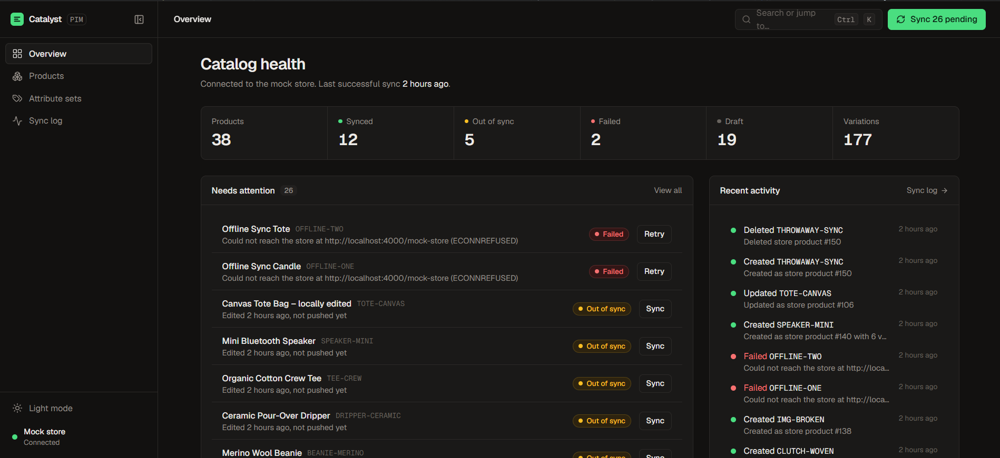
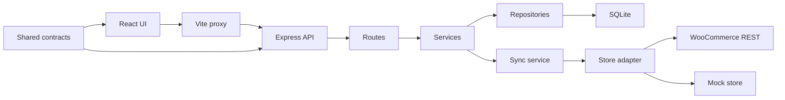
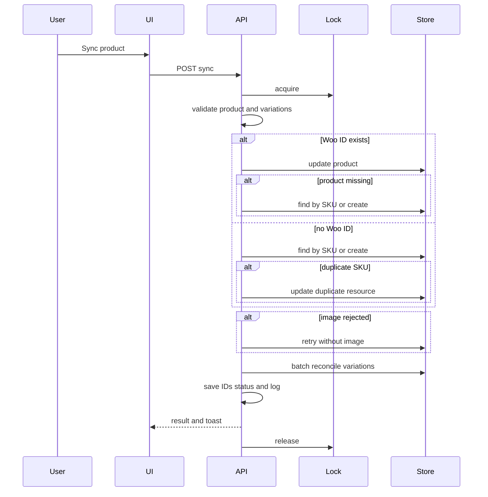
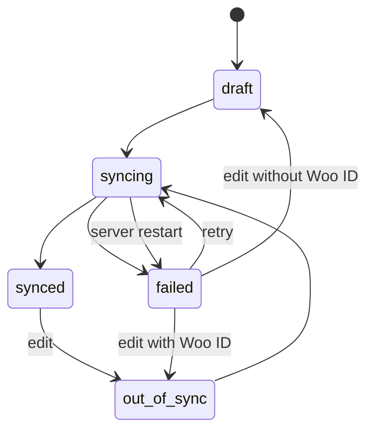
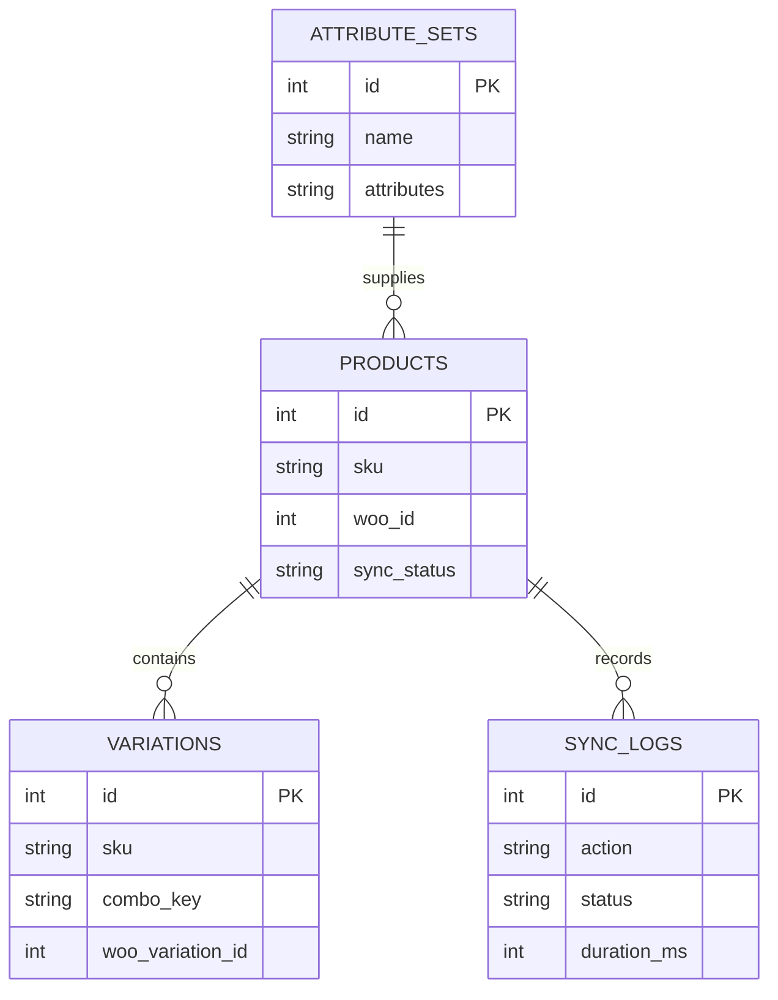

# Catalyst PIM

Catalyst PIM — a product information management system that keeps a WooCommerce catalog consistent, with variable products, attribute sets, and observable sync to and import from WooCommerce.



## The problem

Product data is commonly split between spreadsheets and store administration. Manual copying causes price and variant drift, while the team cannot see what is live or what failed. Catalyst PIM is the local working catalog and makes each store write explicit and observable.

## What it does

- Manages simple and variable products, prices, stock, images, categories, and descriptions.
- Reuses attribute sets and generates variation combinations.
- Syncs to and imports from WooCommerce.
- Records sync results, duration, warnings, and errors.
- Includes a persistent mock store for offline development and demos.

## Key features and their impact

| Feature | How it works | Why it matters |
|---|---|---|
| Status lifecycle | Tracks draft, syncing, synced, out of sync, and failed. | Shows what needs work. |
| SKU reconciliation | Updates by Woo ID or adopts matching store SKU. | Avoids duplicates. |
| Self-healing sync | Repairs missing products and variations, and removes orphans. | Store edits do not break sync. |
| Variation regeneration | Uses combo keys to keep matching price, stock, and IDs. | Keeps useful data. |
| Attribute sets | Reusable option templates. | Faster entry. |
| Image fallback | Retries without image and logs warning. | Bad images do not block sync. |
| Conflict-safe import | Skips locked and locally unsynced products. | Preserves pending work. |
| Concurrency locks | Per-product and import locks. | Prevents overlapping writes. |
| Sync log | Stores action, outcome, duration, and warnings. | Provides auditability. |
| Mock store | Local adapter and storefront. | Supports offline work. |
| Integer paise | Converts only at Woo boundary. | Avoids float errors. |
| Keyboard-first UI | Command palette and shortcuts. | Speeds operator work. |

## Quick start

1. Install Node.js 20 or later and run `npm install`.
2. Windows: `copy .env.example .env`; macOS/Linux: `cp .env.example .env`.
3. Leave `WOO_MODE=mock` for the built-in store.
4. Run `npm run db:seed` or `npm run db:seed:full`.
5. Run `npm run dev`.
6. Open `http://localhost:5173`; the API is at `http://localhost:4000`.

## Connecting a real WooCommerce store

Set permalinks to Post name, create a Read/Write REST API key, then set `WOO_MODE=real`, `WOO_URL`, `WOO_KEY`, and `WOO_SECRET` in `.env`. Restart, check the sidebar indicator, and use Import from store. The client uses Basic auth over HTTPS and OAuth 1.0a signatures over HTTP.

## Architecture

The web and API share Zod schemas and TypeScript contracts. Routes validate input, services own rules and synchronization, repositories own SQLite access, and only sync/import code reaches the store adapter. See [docs/ARCHITECTURE.md](docs/ARCHITECTURE.md).



## Sync flow



## Sync status lifecycle



## Data model



## Design decisions

| Decision | Chosen | Alternatives considered | Why |
|---|---|---|---|
| Contracts | Monorepo shared Zod contracts | Separate repos, duplicated types | One validated vocabulary. |
| Persistence | SQLite and hand-written repositories | ORM, Postgres | Zero setup and transparent queries. |
| Store client | Native fetch adapter | Woo SDK, axios | Controls timeouts, auth, errors. |
| Store testing | Real and mock adapters | Live store only | Repeatable offline work. |
| Money | Integer paise | Floats | Exact price storage. |
| Sync model | Explicit PIM-to-store action | Background sync | Predictable observable writes. |
| Client state | TanStack Query server state | Optimistic status | Server is authoritative. |
| UI | React, Vite, Tailwind tokens | Component kit | Dense operator interface. |

## Edge cases handled

| Scenario | Behaviour | Where |
|---|---|---|
| Invalid environment | Validates real-store URL and credentials at startup. | `config/env.ts` |
| Duplicate and store SKU | Rejects local conflicts and adopts matching store SKU. | `products`, `sync` |
| Deleted product or variation | Recreates linkage on next sync. | `modules/sync/service.ts` |
| Orphan variations | Removes unclaimed remote variations. | `modules/sync/service.ts` |
| Double sync | Holds a per-product lock. | `modules/sync/locks.ts` |
| Bulk partial failure | Continues remaining targets and reports results. | `modules/sync/service.ts` |
| Offline, timeout, bad keys, URL | Normalizes store errors. | `lib/woo` |
| Restart mid-sync | Marks interrupted syncs failed at startup. | `products/repo.ts` |
| Invalid money and stock | Rejects negative values and invalid sale price. | `packages/shared/src/schemas` |
| Outdated or excessive variations | Requires regeneration and caps at 100 combinations. | `modules/variations` |
| Variable to simple | Requires confirmation before variation deletion. | `products/service.ts` |
| Broken image | Retries sync without image and warns. | `sync/service.ts` |
| Delete scope | Supports PIM-only and everywhere deletion. | `products/service.ts` |
| Import conflict and dirty SKU | Preserves local work and sanitizes store SKU. | `import/service.ts` |

## Project structure

| Path | Purpose |
|---|---|
| `apps/server` | Express API, SQLite, sync and import services. |
| `apps/web` | React and Vite operator UI. |
| `packages/shared` | Zod schemas, API contracts, money helpers. |
| `docs` | Architecture guide and screenshots. |
| `data` | Local SQLite and mock data; ignored. |
| `.env.example` | Safe configuration template. |

## API reference

| Method | Endpoint | Purpose |
|---|---|---|
| GET | `/api/health` | API and store health. |
| GET | `/api/stats` | Catalog and sync statistics. |
| GET, POST | `/api/products` | List or create products. |
| GET, PATCH, DELETE | `/api/products/:id` | Read, edit, or delete product. |
| POST | `/api/products/:id/variations/generate` | Generate variations. |
| PATCH | `/api/variations/:id` | Update variation. |
| GET, POST, PATCH, DELETE | `/api/attribute-sets` | Manage attribute sets. |
| GET | `/api/logs` | List sync logs. |
| POST | `/api/sync/bulk` | Sync selected or pending products. |
| POST | `/api/sync/:productId` | Sync one product. |
| POST | `/api/import` | Import store products. |
| GET | `/mock-store` | Mock storefront, mock mode only. |
| POST | `/api/mock-store/offline` | Toggle outage, mock mode only. |
| DELETE | `/api/mock-store/products/:id` | Remove product, mock mode only. |

## Configuration

| Name | Default | Description |
|---|---|---|
| `NODE_ENV` | `development` | Runtime environment. |
| `PORT` | `4000` | API port. |
| `CORS_ORIGIN` | `http://localhost:5173` | Allowed web origin. |
| `DATABASE_PATH` | `./data/pim.db` | SQLite path. |
| `LOG_LEVEL` | `info` | Pino level. |
| `WOO_MODE` | `mock` | Store adapter mode. |
| `WOO_URL` | unset | Real store URL. |
| `WOO_KEY` | unset | Real consumer key. |
| `WOO_SECRET` | unset | Real secret. |
| `WOO_TIMEOUT_MS` | `15000` | Store timeout. |

## Scripts

| Script | Purpose |
|---|---|
| `npm run dev` | Start server and web development processes. |
| `npm run start` | Start the server. |
| `npm run db:migrate` | Apply migrations. |
| `npm run db:seed` | Seed the base catalog. |
| `npm run db:seed:full` | Seed catalog and edge cases. |
| `npm run typecheck` | Typecheck workspaces. |
| `npm run test:smoke` | Run configured server smoke test. |

## Keyboard shortcuts

| Shortcut | Action |
|---|---|
| Ctrl/Cmd K | Command palette. |
| N | New product. |
| / | Search. |
| S | Sync editor product. |
| Ctrl/Cmd S | Save. |

## Testing the edge cases

`npm run db:seed:full` creates draft, synced, out-of-sync, failed, warning, missing-store, outdated-variation, ungenerated-variable, SKU-collision, regeneration, import-only, import-conflict, and deletion-log scenarios.

```powershell
Invoke-RestMethod -Method Post -Uri http://localhost:4000/api/mock-store/offline -ContentType application/json -Body '{"offline":true}'
Invoke-RestMethod -Method Post -Uri http://localhost:4000/api/mock-store/offline -ContentType application/json -Body '{"offline":false}'
```

## Limitations and roadmap

There is no authentication or tenant isolation. SQLite needs persistent storage and attributes are local rather than global WooCommerce attributes. Sync is manual. Planned work includes webhooks, global attributes, Shopify/Amazon adapters, roles and approval workflow, scheduled sync, and CSV import.

## License

MIT. See [LICENSE](LICENSE).
