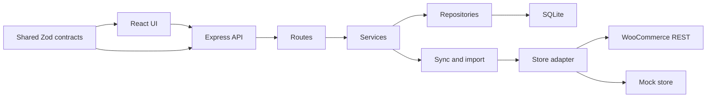
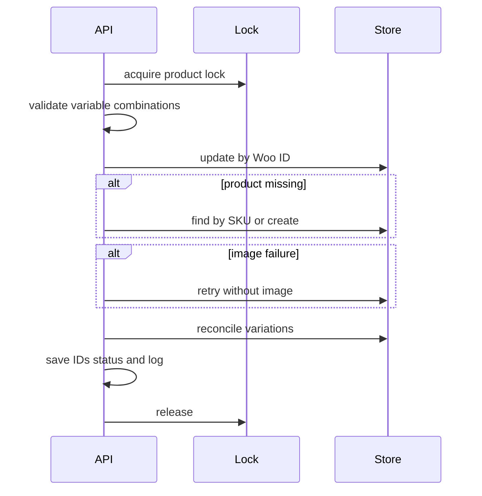
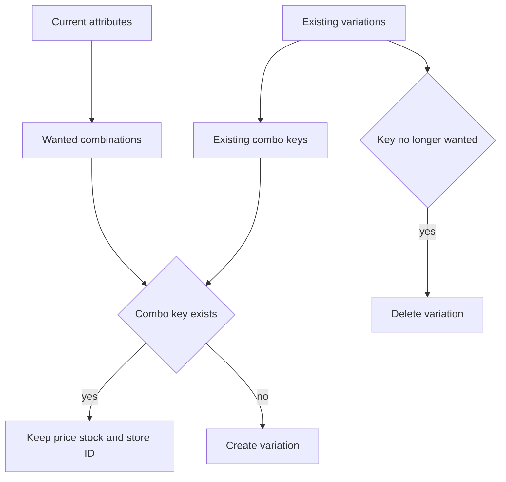
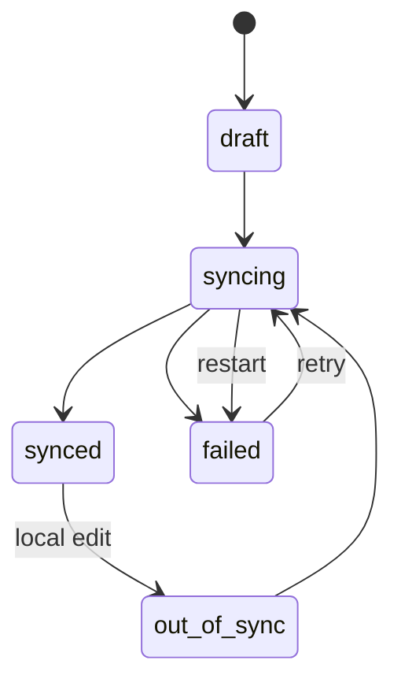
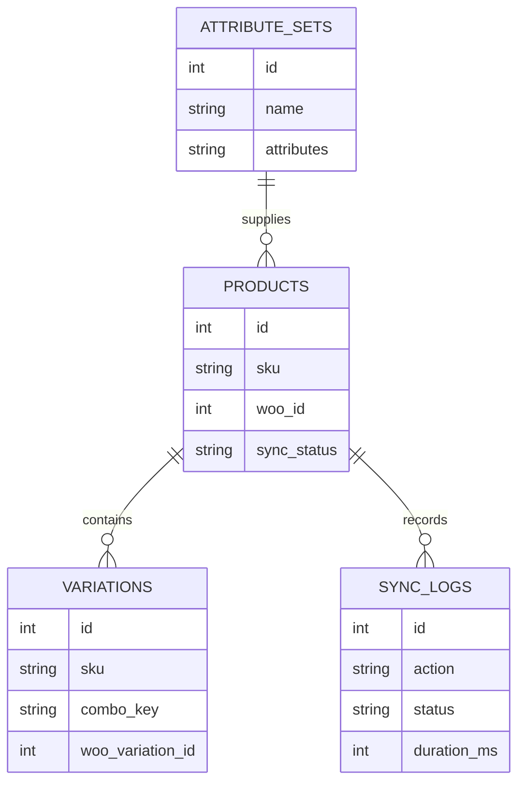

# Architecture

Catalyst PIM is a TypeScript monorepo with a React web application, an Express API, a SQLite database, and a WooCommerce adapter. `packages/shared` supplies the schemas and API contracts used on both sides.

## Layering rules

Routes parse body, query, and path input, call one service, and respond through `send`. Services own validation across records, transactions, status transitions, and external operations. Repositories contain SQLite SQL only. `modules/sync` and `modules/import` are the only application modules allowed to call the Woo adapter; the mock-store routes and seed script may use the mock adapter for demos.

## Error model

Expected failures are `AppError` values. Error middleware serializes them as `{ error: { code, message, fieldErrors } }`; `fieldErrors` is included for validation failures. Unhandled errors become `INTERNAL_ERROR` with HTTP 500.

| Code | Typical HTTP status |
|---|---|
| `VALIDATION_ERROR`, `INVALID_JSON` | 400 |
| `NOT_FOUND`, `ROUTE_NOT_FOUND` | 404 |
| `SKU_TAKEN`, `NAME_TAKEN`, `SYNC_IN_PROGRESS`, `IMPORT_IN_PROGRESS`, `VARIATIONS_EXIST` | 409 |
| `VARIATIONS_OUTDATED`, `TOO_MANY_VARIATIONS`, `NOT_SYNCABLE` | 422 |
| `WOO_TIMEOUT` | 504 |
| `WOO_UNREACHABLE`, `WOO_UNAUTHORIZED`, `WOO_NOT_FOUND`, `WOO_REJECTED`, `WOO_MISCONFIGURED` | 502 when returned by a sync route |
| `NOT_IMPLEMENTED` | 501 |
| `INTERNAL_ERROR` | 500 |

## Sync algorithm

1. Acquire a per-product lock or return `SYNC_IN_PROGRESS`.
2. Load the product and variations. Variable products must have attributes, generated variations, and an exact attribute-combination match.
3. Set status to `syncing`, resolve a category, and build Woo payloads.
4. Update using `wooId`; if missing remotely, clear variation IDs and resolve by SKU or create.
5. Without a Woo ID, find by SKU before create. A duplicate-SKU create response is adopted and updated.
6. Retry once without images when WooCommerce rejects an image download.
7. Reconcile variations, persist returned IDs, then save `synced` status and a success log.
8. On operational failure, save `failed` plus message and a failed log. Always release the lock.

## Variation reconciliation

The service fetches remote variations, matches local rows by remote ID and then case-insensitive SKU, updates matched records, creates unmatched local records, and deletes unmatched remote records. Batches contain at most 100 total create/update/delete operations. An invalid remote variation ID is cleared locally and retried as a create; other per-item errors fail the product sync.

## Variation regeneration

Generation produces Cartesian combinations from product attributes. Existing rows are compared by case-insensitive order-independent `combo_key`. Matching rows survive unchanged; removed combinations are deleted; new combinations receive a unique generated SKU and the product default price.

## Import algorithm

Import holds the single import lock, pages through store products, and accepts only simple or variable records. It normalizes SKU text, then finds a local record by Woo ID or SKU. A locked, failed, or out-of-sync local product becomes a conflict instead of being overwritten. Other products are inserted or updated as `synced`. Variable products fetch remote variations before the database transaction, upsert them by Woo ID, SKU, then combo key, and remove local combinations missing remotely. A single import summary is logged.

## Locking and recovery

Locks are in-memory and intentionally short-lived: one per product sync and one for import. Product and variation editing checks the relevant product lock. On boot, `resetInterruptedSyncs` changes any persisted `syncing` record to `failed`, because a process restart clears every in-memory lock.

## Money handling

SQLite and shared contracts represent money as integer paise. Only `sync/mapper.ts` and `import/service.ts` convert between paise and WooCommerce decimal strings. This keeps comparisons such as sale-less-than-regular exact.

## Status transitions

## Data model

